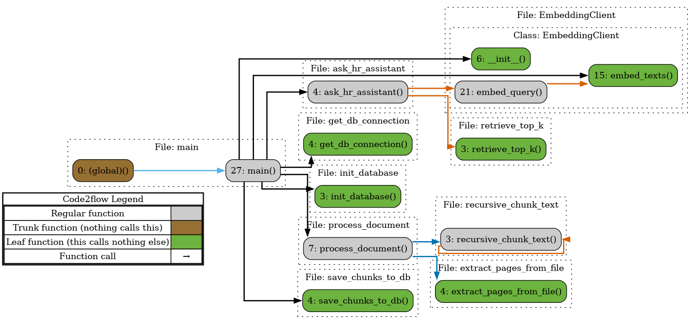
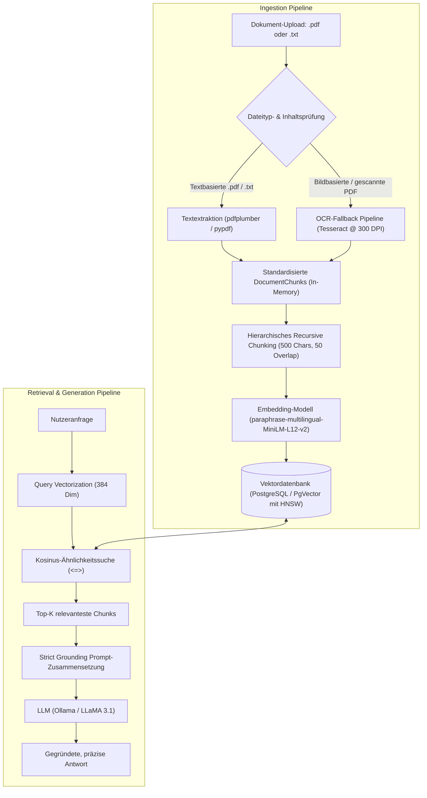

# Technische Dokumentation & Architekturkonzept
## Dokumentenbasierte RAG-Anwendung für Document Question-Answering

## 0. Flowchart



###### erstellt mit code2flow (siehe: https://github.com/scottrogowski/code2flow)

## 1. Zielsetzung

Ziel des Systems ist es, Benutzern den Upload beliebig strukturierter Dokumente (z. B. Lebensläufe, Zeugnisse im PDF- oder Textformat) zu ermöglichen. Anschließend können Fragen zu deren Inhalten beantwortet werden.

Die Architektur basiert auf dem Retrieval-Augmented Generation (RAG) Muster. Dadurch wird sichergestellt, dass das verwendete Large Language Model (LLM) nicht auf sein internes Allgemeinwissen angewiesen ist, sondern Antworten auf Basis der vorhandenen Dokumente generiert.

## 2. Systemarchitektur

Der Gesamtablauf gliedert sich in zwei Hauptpfade:
1. **Ingestion-Pipeline (Indizierung):** Dokumenten-Parsing, OCR (Optical Character Recognition (siehe https://www.adobe.com/acrobat/hub/use-ocr-to-read-text-from-image.html))-Fallback, Chunking, Embedding-Generierung und Vektorspeicherung.
2. **Retrieval- & Generation-Pipeline (Frage-Antwort):** Nutzeranfrage-Embedding, Ähnlichkeitssuche, Context Augmentation und LLM-Synthese.



---

## 3. Komponentendetails & Design-Entscheidungen

### 3.1 Ingestion & Preprocessing
* **Text-Extraktion:** Standard-Dateien (`.txt`, `.pdf` mit eingebetteten Schriftarten) werden über Bibliotheken wie `pypdf` oder `pdfplumber` verarbeitet. Dies stellt den einfachen Fall dar.
* **OCR-Fallback für gescannte Dokumente:** Bewerbungsunterlagen enthalten oft eingescannte Unterschriften oder Zeugnisse, welche unter Umständen an .pdf-Dokumente mit eingebetteten Schriftarten angehängt werden. Das System sollte demnach seitenweise prüfen, ob Text extrahiert werden kann. Fehlt dieser, greift ein OCR-Verfahren (z. B. via `pytesseract` oder `easyocr`). So bleiben auch hybride PDFs (z. B. 2 Textseiten, 1 Scan-Seite) vollständig erhalten.
* **In-Memory Representation:** Dokumente werden als vollständige Objekte mit Metadaten (`file_name`, `page_number`, `document_type`) im Speicher gehalten, anstatt temporäre `.txt`-Dateien auf dem Dateisystem abzulegen.

### 3.2 Indizierung und Vektorisierung
* **Segmentation:** Die Dokumente werden hierarchich segmenteirt, wobei darauf geachtet wird, natürliche Absatzgrenzen zu wahren [Wang et al., 2024]. 
* **Semantic Chunking:** Um semantischen Kontext zu bewahren, werden Texte anhand des `Recursive Chunking (RC)` zerlegt [Shaukat et al., 2026]. Falls ein Segment/Absatz länger als 500 Zeichen sein sollte, wird nicht ab Zeichen 500 abgebrochen. Stattdessen wird anhand der Hierarchie `Absätze(\n\n) --> Sätze(\n) --> Wörter/Leerzeichen( ) --> Zeichen("")` nach dem Satzende gesucht, welche der Oberrgrenze von 500 Zeichen am nächsten kommt (z.B. 474 Zeichen). Hierarchiestufen darunter dienen als Fallback für den unwahrscheinlichen Fall eines nicht endenden Satzes von mehr als 500 Zeichen oder ähnlichen Fällen. Zur Kontextbewahrung tauchen die letzten 50 Zeichen des vorherigen Chunks im derzeitigen auf.
  * *Maximale Chunk-Größe:* ca. 500 Zeichen.
  * *Overlap:* ca. 50 Zeichen (verhindert den Verlust von Zusammenhängen an Chunk-Grenzen).
* **Embeddings & Vector Store:** Die Text-Chunks werden über das vektorielle Embedding-Modell transformiert (in der initialen Konzeption `text-embedding-3-small`, in der finalen Implementierung das datenschutzkonforme lokale Modell `paraphrase-multilingual-MiniLM-L12-v2` via `sentence-transformers` [Shaukat et al., 2026]) und in eine Vektordatenbank `PgVector` mit Indexierung (HNSW) geschrieben. `ChromaDB` wäre ebenso denkbar, schneidet jedoch bei Enterprise-Kriterien (Skalierbarkeit, relationale Verknüpfungen, erweiterte Indizierung) schwächer ab [Patel et al., 2026].
* **Indexing:** HNSW (Hierarchical Navigable Small World) ist einer der populärsten und effizientesten Algorithmen für die Approximate Nearest Neighbor (ANN)-Suche in hochdimensionalen Vektorräumen. Er wird standardmäßig von modernen Vektordatenbanken genutzt.

### 3.3 Retrieval & LLM Generation (Stufe 3)
* **Query Vectorization:** Die Nutzerfrage wird mit demselben Embedding-Modell ins Vektorformat übertragen.
* **Similarity Search:** Über Kosinusähnlichkeit werden die $K$ ähnlichsten Textabschnitte ($K = 5$) ermittelt [Shaukat et al., 2026].
* **Strict Context Prompting:** Der gefundene Kontext wird zusammen mit der Frage in ein Prompting-Schema eingebettet:

```text
System: Du bist ein präziser HR-Assistent. Beantworte die Frage ausschließlich basierend auf den bereitgestellten Dokumentenauszügen. Wenn eine Information nicht enthalten ist, antworte ehrlich mit "Information nicht im Dokument enthalten".

Context:
[Chunk 1]
[Chunk 2]
[Chunk 3]
[Chunk 4]
[Chunk 5]

User Query: {User-Anfrage}
```

## 4. Beispiel des Aufrufs anhand der Datei "Dateien/Lebenslauf.txt"

### Fragenkatalog

```code
sample_queries = [
    "Wie lautet der Name des Bewerbers?",
    "Welche Fähigkeiten werden im Lebenslauf genannt?",
    "Wann hat der Bewerber seinen letzten Job begonnen?",
    "Welchen Führerschein besitzt der Bewerber?",
    "Wie lautet die Telefonnummer des Bewerbers und was ist seine Körpergröße?",
    "Ist der Bewerber deutscher Staatsbürger?"
]
```

### Ausgabe

```text
============================================================
Frage: Wie lautet der Name des Bewerbers?
============================================================
[Retrieval] 5 relevanteste Chunks gefunden (Top-K=5):
  1. [Score: 0.2215 | Lebenslauf.txt (S. 1)]: \item \textbf{Sprachen:} Deutsch (Muttersprache), Englisch (Fließend), Französisch (Grundk...
  2. [Score: 0.2102 | Lebenslauf.txt (S. 1)]: \begin{document} \pagestyle{empty}  \begin{center}     {\Huge \textbf{Tim Christoph Rauneg...
  3. [Score: 0.1590 | Lebenslauf.txt (S. 1)]: \item \textbf{Raunegger-Müller, T. C.}, Khalifeh, A., \& Ludwig, S. \textit{An Attention-b...
  4. [Score: 0.1464 | Lebenslauf.txt (S. 1)]: \href{https://orcid.org/0009-0005-9279-0146}{orcid.org/0009-0005-9279-0146} \quad | \quad ...
  5. [Score: 0.1443 | Lebenslauf.txt (S. 1)]: \section{Publikationen} \begin{itemize}[noitemsep, topsep=2pt, leftmargin=*]     \item \te...

Antwort des HR-Assistenten:
Der Name des Bewerbers lautet Tim Christoph Raunegger-Müller.


============================================================
Frage: Welche Fähigkeiten werden im Lebenslauf genannt?
============================================================
[Retrieval] 5 relevanteste Chunks gefunden (Top-K=5):
  1. [Score: 0.3227 | Lebenslauf.txt (S. 1)]: \item Erstellung mehrerer Data-Analytics-Dashboards zur Visualisierung von Produktionsdate...
  2. [Score: 0.2909 | Lebenslauf.txt (S. 1)]: \textbf{BSH Hausgeräte Gruppe} \hfill Giengen an der Brenz, Deutschland \\ \textit{Data An...
  3. [Score: 0.2585 | Lebenslauf.txt (S. 1)]: \item \textbf{Data \& Analytics:} NumPy, Pandas, SQL, Data Analytics, Matlab, Tableau, Mat...
  4. [Score: 0.2468 | Lebenslauf.txt (S. 1)]: \vspace{10pt}  \section{Ausbildung} \textbf{Hochschule Aalen} \hfill Aalen, Deutschland \\...
  5. [Score: 0.2168 | Lebenslauf.txt (S. 1)]: \item \textbf{Beschreibung:} Entwicklung und Evaluation eines Attention-basierten Deep-Lea...

Antwort des HR-Assistenten:
Basierend auf dem bereitgestellten Dokument sind folgende Fähigkeiten im Lebenslauf genannt:

1. **Data-Analytics-Fähigkeiten:**
        * NumPy
        * Pandas
        * SQL
        * Data Analytics
        * Matlab
        * Tableau
        * Matplotlib
2. **Software- und Engineering-Fähigkeiten:**
        * C++
        * Objektorientierte Programmierung
        * Git
        * Full-Stack IoT Engineering
3. **Cloud- und Entwicklung-Fähigkeiten:**
        * Microsoft Azure
        * Scrum
        * \LaTeX
4. **Domain-Fähigkeiten:**
        * IoT
        * Datenpipelines
5. **Soft Skills:**
        * Analytische Problemlösung
        * Interkulturelle Kommunikation
        * Team-Mentoring
        * Abteilungsübergreifende Zusammenarbeit


============================================================
Frage: Wann hat der Bewerber seinen letzten Job begonnen?
============================================================
[Retrieval] 5 relevanteste Chunks gefunden (Top-K=5):
  1. [Score: 0.1591 | Lebenslauf.txt (S. 1)]: \section{Berufserfahrung} \textbf{NetCom BW GmbH} \hfill Ellwangen, Deutschland \\ \textit...
  2. [Score: 0.1591 | Lebenslauf.txt (S. 1)]: \textbf{BSH Hausgeräte Gruppe} \hfill Giengen an der Brenz, Deutschland \\ \textit{Data An...
  3. [Score: 0.1448 | Lebenslauf.txt (S. 1)]: \begin{document} \pagestyle{empty}  \begin{center}     {\Huge \textbf{Tim Christoph Rauneg...
  4. [Score: 0.1421 | Lebenslauf.txt (S. 1)]: \section{Projekte} \textbf{Eigenes Homelab \& KI-Infrastruktur} \hfill Nov. 2024 -- jetzt ...
  5. [Score: 0.1337 | Lebenslauf.txt (S. 1)]: \vspace{6pt}  \textbf{Hochschule Aalen} \hfill Aalen, Deutschland \\ \textbf{Bachelor of E...

Antwort des HR-Assistenten:
Der Bewerber hat seinen letzten Job bei NetCom BW GmbH als Network Engineer (Werkstudent) im November 2024 begonnen.


============================================================
Frage: Welchen Führerschein besitzt der Bewerber?
============================================================
[Retrieval] 5 relevanteste Chunks gefunden (Top-K=5):
  1. [Score: 0.0797 | Lebenslauf.txt (S. 1)]: \item Konfiguration der Netzwerk- \& Sicherheitsarchitektur über Reverse Proxies (Nginx Pr...
  2. [Score: 0.0750 | Lebenslauf.txt (S. 1)]: \begin{document} \pagestyle{empty}  \begin{center}     {\Huge \textbf{Tim Christoph Rauneg...
  3. [Score: 0.0569 | Lebenslauf.txt (S. 1)]: \textbf{BSH Hausgeräte Gruppe} \hfill Giengen an der Brenz, Deutschland \\ \textit{Data An...
  4. [Score: 0.0568 | Lebenslauf.txt (S. 1)]: \item \textbf{Sprachen:} Deutsch (Muttersprache), Englisch (Fließend), Französisch (Grundk...
  5. [Score: 0.0479 | Lebenslauf.txt (S. 1)]: \item \textbf{Data \& Analytics:} NumPy, Pandas, SQL, Data Analytics, Matlab, Tableau, Mat...

Antwort des HR-Assistenten:
Information nicht im Dokument enthalten.


============================================================
Frage: Wie lautet die Telefonnummer des Bewerbers und was ist seine Körpergröße?
============================================================
[Retrieval] 5 relevanteste Chunks gefunden (Top-K=5):
  1. [Score: 0.1619 | Lebenslauf.txt (S. 1)]: \begin{document} \pagestyle{empty}  \begin{center}     {\Huge \textbf{Tim Christoph Rauneg...
  2. [Score: 0.1098 | Lebenslauf.txt (S. 1)]: \href{https://orcid.org/0009-0005-9279-0146}{orcid.org/0009-0005-9279-0146} \quad | \quad ...
  3. [Score: 0.1055 | Lebenslauf.txt (S. 1)]: \item \textbf{Sprachen:} Deutsch (Muttersprache), Englisch (Fließend), Französisch (Grundk...
  4. [Score: 0.0953 | Lebenslauf.txt (S. 1)]: \textbf{BSH Hausgeräte Gruppe} \hfill Giengen an der Brenz, Deutschland \\ \textit{Data An...
  5. [Score: 0.0785 | Lebenslauf.txt (S. 1)]: \item \textbf{Beschreibung:} Entwicklung und Implementierung eines Machine-Learning-Modell...

Antwort des HR-Assistenten:
Ich kann diese Informationen nicht finden.


============================================================
Frage: Ist der Bewerber deutscher Staatsbürger?
============================================================
[Retrieval] 5 relevanteste Chunks gefunden (Top-K=5):
  1. [Score: 0.3895 | Lebenslauf.txt (S. 1)]: \begin{document} \pagestyle{empty}  \begin{center}     {\Huge \textbf{Tim Christoph Rauneg...
  2. [Score: 0.2985 | Lebenslauf.txt (S. 1)]: \vspace{6pt}  \textbf{Hochschule Aalen} \hfill Aalen, Deutschland \\ \textbf{Bachelor of E...
  3. [Score: 0.2482 | Lebenslauf.txt (S. 1)]: \item \textbf{Sprachen:} Deutsch (Muttersprache), Englisch (Fließend), Französisch (Grundk...
  4. [Score: 0.2246 | Lebenslauf.txt (S. 1)]: \textbf{BSH Hausgeräte Gruppe} \hfill Giengen an der Brenz, Deutschland \\ \textit{Data An...
  5. [Score: 0.2043 | Lebenslauf.txt (S. 1)]: \vspace{10pt}  \section{Ausbildung} \textbf{Hochschule Aalen} \hfill Aalen, Deutschland \\...

Antwort des HR-Assistenten:
Ja, der Bewerber ist deutscher Staatsbürger, da er in Deutschland lebt und seine Kontaktdaten (Adresse und Telefonnummer) in Deutschland angegeben sind.
```