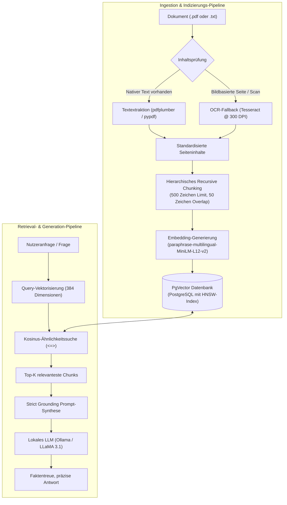
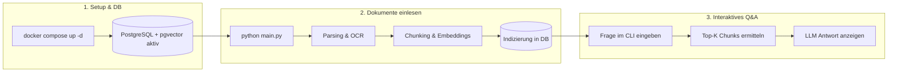

# Document-Based RAG Application

Eine modulare, lokale Retrieval-Augmented Generation (RAG) Pipeline zur semantischen Beantwortung von Fragen über unstrukturierte Dokumente (PDFs mit nativem Text oder Scans sowie Textdateien).

Das System kombiniert automatische OCR-Texterkennung, hierarchisches rekursives Chunking, mehrsprachige dichte Vektoreinbettungen, HNSW-indizierte Vektorsuche in PostgreSQL (`pgvector`) und strikt quellengestützte LLM-Generierung über lokale Sprachmodelle (Ollama).

---

## 1. Systemarchitektur & Ablauf

### Architektur-Übersicht



### Nutzung & Pipeline-Ablauf



---

## 2. Kernfunktionen & Design-Entscheidungen

* **Multi-Tier Extraktion mit OCR-Fallback (`Funktionen/extract_pages_from_file.py`):**
  * Verarbeitet `.txt` und `.pdf`.
  * Erkennt hybride Dokumente (z. B. PDFs mit digitalen Textseiten und eingescannten Anhängen).
  * Seiten ohne eingebettete Zeichen werden mit Tesseract OCR bei 300 DPI verarbeitet.
* **Hierarchisches semantisches Chunking (`Funktionen/recursive_chunk_text.py`):**
  * Rekursiver Abbau entlang linguistischer Grenzen: Absätze (`\n\n`) &rarr; Sätze/Zeilen (`\n`) &rarr; Wörter (` `) &rarr; Zeichen (`""`).
  * Zielgröße ~500 Zeichen mit 50 Zeichen Überlappung zur Wahrung des lokalen Kontexts.
* **Lokale mehrsprachige Embeddings (`Klassen/EmbeddingClient.py`):**
  * Modell: `paraphrase-multilingual-MiniLM-L12-v2` (384 Dimensionen).
  * Vollständig lokale Ausführung für DSGVO-Konformität und Unabhängigkeit von externen APIs.
* **Enterprise-taugliche Vektorspeicherung (`Funktionen/init_database.py`, `Funktionen/save_chunks_to_db.py`):**
  * PostgreSQL mit `pgvector`-Erweiterung.
  * HNSW-Indexierung (`vector_cosine_ops`) für logarithmische Suchkomplexität bei Kosinusähnlichkeit.
* **Striktes Grounding & Halluzinationsvermeidung (`Funktionen/ask_hr_assistant.py`):**
  * Das Systemprompt instruiert das LLM, ausschließlich aus den übergebenen Kontext-Chunks zu antworten und bei fehlenden Daten transparent darauf hinzuweisen.

---

## 3. Voraussetzungen

* **Betriebssystem:** Linux, macOS oder Windows (WSL2 empfohlen)
* **Python:** Version 3.10 oder neuer
* **Docker & Docker Compose:** Für den PostgreSQL/PgVector-Container
* **Tesseract OCR:** Für gescannte PDF-Seiten
  * Debian/Ubuntu: `sudo apt-get install tesseract-ocr tesseract-ocr-deu`
  * macOS: `brew install tesseract tesseract-lang`
* **Ollama:** Lokal oder auf einem Server mit geladenem Modell:
  * `ollama pull llama3.1`

---

## 4. Installation & Schnellstart

### 1. Repository klonen & Abhängigkeiten installieren

```bash
# Virtuelle Umgebung erstellen und aktivieren
python3 -m venv .venv
source .venv/bin/activate

# Abhängigkeiten installieren
pip install -r requirements.txt
```

### 2. Vektordatenbank starten

```bash
docker compose up -d
```

### 3. Konfiguration anpassen (Optional)

Kopiere die Vorlage `.env.example` nach `.env` und passe bei Bedarf Host und Modell an:

```bash
cp .env.example .env
```

Standardwerte:
* `POSTGRES_HOST=localhost`
* `POSTGRES_PORT=5432`
* `POSTGRES_DB=rag_db`
* `POSTGRES_USER=postgres`
* `POSTGRES_PASSWORD=postgrespassword`
* `OLLAMA_BASE_URL=http://localhost:11434/v1` (oder deine eigene Ollama-Instanz)
* `OLLAMA_MODEL=llama3.1:latest`

### 4. Anwendung ausführen

Dokumente können direkt als Argumente übergeben werden:

```bash
# Einzelnes Dokument
python3 main.py Dateien/Lebenslauf.txt

# Mehrere Dokumente (z. B. PDF und TXT)
python3 main.py Dateien/Lebenslauf.pdf "Dateien/Zeugnisse Master und Bachelor.pdf"
```

Alternativ ohne Argumente starten, um Pfade interaktiv abzufragen:

```bash
python3 main.py
```

Nach der Indizierung öffnet sich die interaktive Eingabeaufforderung für Fragen. Mit `exit` oder `q` wird das Programm beendet.

---

## 5. Projektstruktur

```text
.
├── docker-compose.yml              # PgVector Container-Definition (pg16)
├── requirements.txt                # Python-Abhängigkeiten
├── .env.example                    # Vorlage für Umgebungsvariablen
├── .gitignore                      # Git-Ausschlussregeln
├── LICENSE                         # MIT-Lizenz
├── README.md                       # Projektdokumentation & Architektur
├── main.py                         # Zentraler CLI-Einstiegspunkt
│
├── Klassen/                        # Datenstrukturen & Vektorisierungs-Clients
│   ├── DocumentChunk.py            # Dataclass für Chunks mit Metadaten
│   ├── DocumentChunk.md            # Dokumentation zu DocumentChunk
│   ├── EmbeddingClient.py          # SentenceTransformers-Wrapper (lokales Modell)
│   └── EmbeddingClient.md          # Dokumentation zu EmbeddingClient
│
├── Funktionen/                     # Modulare Pipeline-Funktionen
│   ├── extract_pages_from_file.py  # Text-Extraktion mit OCR-Fallback
│   ├── recursive_chunk_text.py     # Hierarchischer Chunking-Algorithmus
│   ├── process_document.py         # End-to-End Dokument-Ingestion
│   ├── get_db_connection.py        # PostgreSQL Verbindungsaufbau
│   ├── init_database.py            # DB-Schema & HNSW-Index Initialisierung
│   ├── save_chunks_to_db.py        # Batch-Insert von Embeddings
│   ├── retrieve_top_k.py           # Kosinusähnlichkeitssuche (<=>)
│   ├── ask_hr_assistant.py         # Prompt-Synthese & LLM-Inferenz
│   └── *.md                        # Detaillierte Moduldokumentation & FAQ
│
├── Dateien/                        # Beispieldokumente für Tests
│   ├── Lebenslauf.txt              # Beispiel-Lebenslauf (LaTeX/Text)
│   ├── Lebenslauf.pdf              # Beispiel-Lebenslauf (PDF)
│   └── Zeugnisse Master und Bachelor.pdf
│
├── Dokumentation/                  # Vertiefende technische Dokumentation
│   ├── architecture_documentation.md # Umfassendes Architekturkonzept & Testbeispiele
│   ├── alle_funktionen_und_klassen.md # Gesamtreferenz aller Module & Design-FAQ
│   ├── Brainstorming.md            # Initiale Konzeptnotizen
│   ├── Klassen/                    # Moduldokumentationen
│   └── Funktionen/                 # Funktionsdokumentationen
│
├── Quellen/                        # Wissenschaftliche Fachliteratur
│   ├── Searching for Best Practices in Retrieval-Augmented Generation.pdf
│   ├── View of Benchmarking Open Source Vector Databases.pdf
│   └── A Systematic Investigation of Document Chunking Strategies and Embedding Sensitivity.pdf
│
├── flow_diagramm.gv                # Graphviz DOT Source des Callgraphs
└── flow_diagramm.png               # Visualisierter Ablaufplan (code2flow)
```

---

## 6. Weiterführende Dokumentation

* [Architekturkonzept & Testläufe](file:///home/tim/Schreibtisch/RAG/Dokumentation/architecture_documentation.md): Detaillierte Auswertungen, Beispielausgaben und Messergebnisse.
* [Detaillierte Code- & Modulreferenz](file:///home/tim/Schreibtisch/RAG/Dokumentation/alle_funktionen_und_klassen.md): Schnittstellen, Komplexitätsanalysen und Design-Entscheidungen aller Komponenten.

---

## 7. Literatur & wissenschaftliche Grundlagen

Die Implementierung basiert auf etablierten Best Practices aktueller RAG-Forschung:

1. **Chunking & Embedding-Sensitivität:** Shaukat et al. (2026) – *A Systematic Investigation of Document Chunking Strategies and Embedding Sensitivity*.
2. **RAG-Architekturrichtlinien:** Wang et al. (2024) – *Searching for Best Practices in Retrieval-Augmented Generation*.
3. **Vektordatenbank-Benchmarking:** Patel et al. (2026) – *Benchmarking Open Source Vector Databases*.

---

## 8. Lizenz

Dieses Projekt steht unter der [MIT-Lizenz](file:///home/tim/Schreibtisch/RAG/LICENSE).
